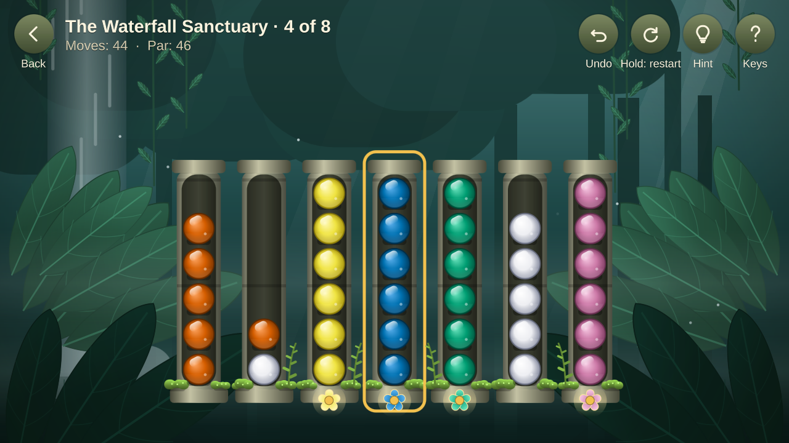

# Hueometry

A colour-sorting puzzle for Omarchy, for children and families. Sort the
glowing jungle orbs so every pillar holds one colour, using the empty pillar
as space, in as few moves as you can. Any orb may sit on any colour; you move
one orb at a time, always the top one.



Explore the Lost Jungle Temple through a short tutorial and six areas of eight
puzzles, or pick a size in free play. There is no timer, no account, no
network, no advertising and no tracking. Progress is saved on your computer.

The rules engine is written in [Bend 2](https://github.com/bendlang/bend), and
its gameplay laws are machine-checked proofs: see [LAWS.bend](LAWS.bend).

## Install

Hueometry needs Omarchy 4.5 or newer.

### As an app (recommended)

Download the package from the
[latest release](https://github.com/BVisagie/omarchy-hueometry/releases/latest)
and install it:

```sh
sudo pacman -U hueometry-0.1.0-1-x86_64.pkg.tar.zst
```

Or build it yourself from a checkout (needs `base-devel`):

```sh
git clone https://github.com/BVisagie/omarchy-hueometry
cd omarchy-hueometry
bin/install
```

`bin/install` builds the game and installs it as an Arch package (it asks for
your password). Either way Hueometry appears in the app launcher. It opens
full screen; F11 switches to a window.

To remove it: `sudo pacman -R hueometry`.

### As an Omarchy shell plugin

The plugin runs the same game as a full-screen overlay inside the Omarchy
shell, opened from an orb (◉) in the bar. Install it from its own
repository (it is also submitted to the
[plugin marketplace](https://omarchyplugins.com/)):

```sh
omarchy plugin add https://github.com/BVisagie/omarchy-hueometry-plugin --enable
```

To open it with a key, add to `~/.config/hypr/bindings.lua`:

```lua
o.bind("SUPER + SHIFT + H", "Hueometry", "omarchy-shell shell summon io.github.bvisagie.hueometry '{}'")
```

Sound needs Qt Multimedia
(`omarchy-pkg-add qt6-multimedia`); without it the plugin plays silently. To
remove it: `omarchy plugin remove io.github.bvisagie.hueometry`.

The main menu shows the version in its bottom corner: `v0.1.0` for a
release, or with the commit (`v0.1.0 · 9323709`) for a build made from any
other point in the repository or with local changes.

Both ways share one save: progress in `~/.local/share/hueometry`, settings in
`~/.config/hueometry`. Delete those folders to forget them.

## Playing

Click a pillar to lift its top orb, then click another pillar to put it down.
A pillar that can take the orb glows, and a pillar full of one colour
blooms with a flower in that colour. The puzzle is solved when every orb
shares its pillar with only its own colour and one pillar is empty.

| Key | Does |
|---|---|
| ← → or 1–9 | choose a pillar |
| Space or Enter | lift an orb, or put it down |
| Esc | put the orb back, or go back |
| U or Ctrl+Z | undo a move |
| R, then R (or hold the button) | start the puzzle again |
| H | a hint |
| ? | all keys |
| F11 | full screen (app) |
| Q, then Q | quit (app) |
| Q | close (shell plugin) |

Settings: music and sound volumes, silence, symbols on the orbs (for colour
blindness), less movement, line or circle boards, and the size of words and
buttons.

## How it is made

| Part | Where |
|---|---|
| Rules engine, generation and hints | `engine/*.bend` (Bend 2) |
| The rules, stated as laws | `SPEC.bend`, `LAWS.bend` |
| Their proofs | `PROOF.bend`, checked by `bin/proof` |
| The engine for Qt | `qml/Hueometry/js/engine.mjs`, built by `bin/engine` |
| The game | `qml/Hueometry/` (Qt Quick, shared by both installs) |
| The app | `src/`, `hueometry.pro`, `pkgbuild/` |
| The shell plugin | `plugin/`, assembled by `bin/plugin` |
| Levels, sounds | `bin/levels`, `bin/audio` |

[ARCHITECTURE.md](ARCHITECTURE.md) explains how the parts fit,
[FEASIBILITY.md](FEASIBILITY.md) what is proved and what is tested, and
[docs/releasing.md](docs/releasing.md) how a release is cut.

To work on it: `bin/setup` installs the pinned Bend and Lean into your home
folder, and `bin/check` runs everything CI runs (proofs, engine tests in Node
and in Qt's engine, the app build, the plugin check, palette and sound
checks).

## Licences

Code: [MIT](LICENSE). Art and audio: [CC BY-SA 4.0](LICENSE-ASSETS); every
asset is listed in [ASSETS.md](ASSETS.md).
